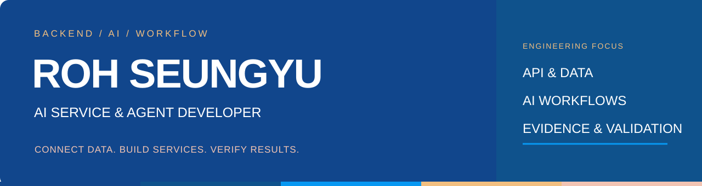
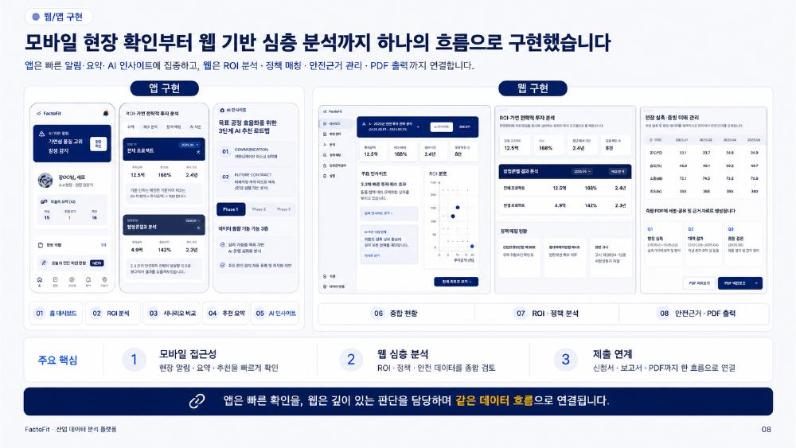

  

<h1 align="center">노승유 · ROH SEUNGYU</h1>

<strong>AI의 판단을 실제 서비스로 연결합니다.</strong>

Python·FastAPI·Supabase로 데이터와 기능을 연결하고, 
AI 출력의 근거와 오류를 확인하는 개발자입니다.

  <a href="#featured-projects">Projects</a> ·
  <a href="#engineering-notes">Engineering Notes</a> ·
  <a href="https://github.com/seungyu14-cel?tab=repositories">Repositories</a>

---

## About Me

- **Backend integration** — 기업·정책·문서 데이터를 API와 DB로 연결합니다.
- **Grounded AI** — 생성 문구의 근거와 구조화된 응답을 확인합니다.
- **Problem solving** — 오류를 설정·모델 호출·파싱·저장 단계로 나누어 분석합니다.
- **Workflow design** — AI가 해석할 부분과 규칙으로 판단할 부분을 구분합니다.

## Tech Stack

| 영역 | 기술·경험 |
| --- | --- |
| Backend & Data | Python · FastAPI · Supabase · PostgreSQL |
| AI 문서 처리 | Ollama · OCR · 구조화 응답 · 근거 관리 |
| SPORTS SISEON | LangChain 근거 검색 · LangGraph 카드별 검수·수정 · SQLite Feedback Memory |
| 팀 프로젝트 적용 | FACTOFIT의 LangGraph 어드바이저 · ChromaDB 정책 검색 |
| Collaboration | Git · GitHub · API·DB 연동 테스트 |

직접 담당한 작업과 팀이 구현한 기능은 각 프로젝트 설명에서 구분했습니다.

---

## Featured Projects

### 01 / FACTOFIT

**제조기업의 설비투자 분석과 정부지원사업 탐색을 연결하는 AI 서비스**

`TEAM PROJECT` · `BACKEND LEAD` · `서비스 구현`

**문제** — 기업정보 입력부터 투자 효과 검토, 지원사업 탐색과 신청 준비까지의 단절된 흐름.

**나의 역할**
- FastAPI·Supabase 기반 API와 DB, 배포·테스트를 담당했습니다.
- 기업·설비·정책·문서 정보를 연결하고 화면에 필요한 응답 구조를 조정했습니다.
- 공고의 금액·기한·자격요건과 근거 문장, 검증 상태를 구조화했습니다.
- OCR 제목 추출·문서 분류의 모델 호출, JSON 파싱, DB 스키마 오류를 점검했습니다.

**팀 구현 범위** — ROI 분석, 정책 매칭, 신청서 초안·PDF, LangGraph 기반 AI 어드바이저. 위 화면과 전체 서비스 기능은 팀 결과물입니다.

[팀 저장소](https://github.com/EOCHAEEUN/0.0) · [개인 기여와 개발 기록](docs/factofit.md)

---

### 02 / SPORTS SISEON

**원문 MD를 바탕으로 생성·검수하는 스포츠 카드뉴스 제작 프로젝트**

`PERSONAL PROJECT` · `LOCAL LLM` · `개발·검증 중`

뉴스 자료를 카드뉴스로 가공하면서 생기는 근거 누락, 수치 변경, 내용 중복을 다룹니다.

- **제작 흐름** — MD 업로드 → Ollama 편집 → 역할별 처리·검수 → 카드뉴스 PNG 출력.
- **역할 설계** — 뉴스 가치, 편집 흐름, 숫자 검증, 경기 식별의 기준을 구분합니다.
- **근거 검색·검수** — KBO 제작 경로에 LangChain 검색과 LangGraph 카드별 검수·수정 구조를 적용합니다.
- **예외 처리** — 실패한 카드를 재검토하고, 통과하지 못한 결과는 검토 대기로 구분합니다.
- **피드백** — 수정 규칙을 SQLite Feedback Memory에 기록해 다음 작업에 참고하는 구조입니다.

검증 범위는 업로드한 MD와 생성 결과의 일치 확인입니다. 공식 기록에 대한 외부 사실 검증과는 구분하며, 다양한 원문 형식에서 발생하는 오류를 개선하고 있습니다. Feedback Memory는 모델 가중치 재학습을 의미하지 않습니다.

[저장소](https://github.com/seungyu14-cel/Sports-Card-New) · [개발·검수 안내](https://github.com/seungyu14-cel/Sports-Card-New/blob/main/docs/KBO_GROUNDED_MILESTONE.md) · [프로젝트 설명](docs/sports-siseon.md)

---

### 03 / 기브아이즈 · 드림릴레이 : 단비

**재난 물품 기부의 발송 전 판정과 전달 기록을 위한 서비스 설계**

`TEAM PROJECT` · `RULE & DATA DESIGN` · `설계·프로토타입 검증`

**나의 담당** — 품목 코드·별칭, 차단 규칙·법적 근거, 요금표.

- 서로 다른 물품 표현을 표준 품목으로 정리하는 기준을 설계했습니다.
- 위험·금지 조건과 근거를 구조화했습니다.
- 무게·규격·요금 등 판정과 배송 안내에 필요한 기준을 정리했습니다.

**팀 설계 범위** — 공지를 처리하는 수요 Agent와 사진 인식·품목 판정을 연결하는 기부 Agent. AI 해석, 규칙 판정, 관리자 승인을 구분합니다. 전체 Agent 구현 완료나 현장 운영 성과로 제시하지 않습니다.

[설계와 개인 기여](docs/give-eyes.md)

---

## Engineering Notes

| 주제 | 살펴본 문제 | 연결 자료 |
| --- | --- | --- |
| OCR 처리 | 모델 호출·JSON 파싱·DB 컬럼 불일치 | [FACTOFIT 기록](docs/factofit.md#오류를-나누어-살펴본-경험) |
| 생성 근거 | 원문에 없는 근거와 표현 차이의 구분 | [SPORTS SISEON 기록](docs/sports-siseon.md#검증과-개선) |
| 판단 기준 | 품목 정규화와 규칙 기반 차단 | [기브아이즈 기록](docs/give-eyes.md#직접-담당한-기준-데이터) |

문제를 이해하고, 연결하고, 근거로 확인합니다.

